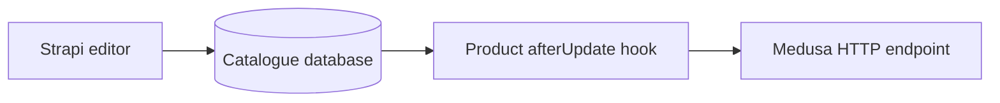

# Strapi commerce catalogue

A 2023 Strapi 4 project based on the [Strapi Medusa template](https://github.com/shahednasser/strapi-medusa-template). It models catalogue content in a CMS and forwards edited product data to a separate Medusa service.

## Architecture

See the [product schema](src/api/product/content-types/product/schema.json) and its [lifecycle hook](src/api/product/content-types/product/lifecycles.js). Variant and region types also have lifecycle modules. SQLite is the default local database.

## Decisions and reliability

The product hook sends an HTTP request after the CMS update. This makes the integration easy to follow. If the remote endpoint fails after the database write, the two systems can disagree. The hook has no durable queue, replay ledger or retry policy. Confirm synchronization at the receiving service before depending on it.

## Run locally

Use a Node version supported by `package.json` (16 through 20). Install dependencies with `npm ci`, configure local Strapi secrets using the environment template and run `npm run develop`. To exercise the product update, provide a compatible Medusa receiver on localhost port 9000 at `/hooks/update-medusa`. That receiver is maintained separately.

## Verification and limitations

Edit a synthetic product and inspect the payload at the receiver. Then stop the receiver and repeat to observe the failure boundary. There is no automated integration test or test script in this package. The old dependencies and linked service require local setup before end-to-end use.